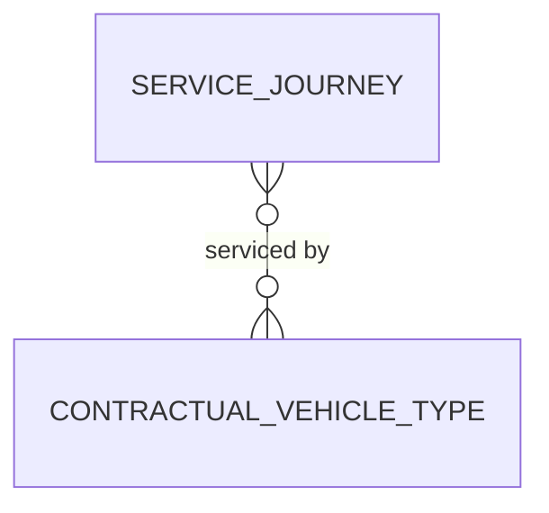
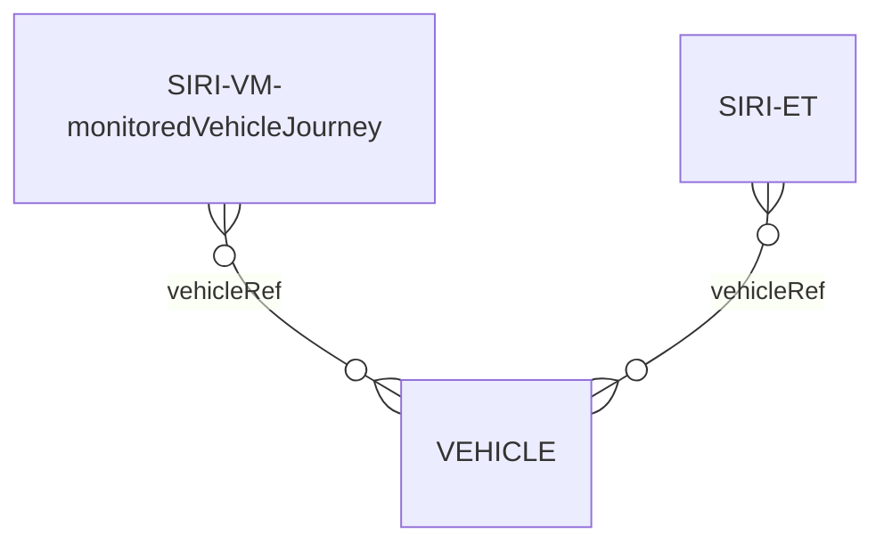
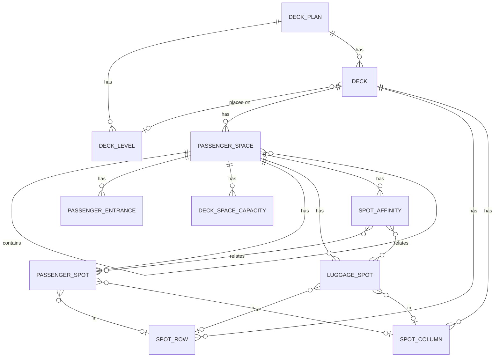

# Sobek data model

A simplified view of the core entities in Sobek. It leaves out detail that is not needed to understand how the entities relate.

## Entity-relationship diagrams

### Contractual data space

### Vehicles - realtime data

### Deck plan

## Simplifications

- **`CONTRACTUAL_VEHICLE_TYPE`** 
- **`DECK_PLAN`** stands for the whole deck plan tree: `DeckLevel`, `Deck`, `DeckSpace`, `PassengerSpace`, `PassengerSpot`, `SpotRow`, `SpotColumn`, `LocatableSpot`, `SchematicMap` and the equipment placed on them.
- **Left out entirely:** `Equipment` and `VehicleEquipmentProfile`, the `KeyValue`, `CodeValue` and `AlternativeName` helper entities, and `ExportJob`.
- Only a subset of the attributes is listed for each entity.
- Every entity is versioned. The key is `id` plus `version`, and the relationships are drawn between entities rather than between specific versions.
- `dataOwnerRef` marks the data owner and is used for authorisation.
